<div align="center">

# 司南 · Sinan

**设备安装调试期的现场问题闭环系统：一份数据，双端记录，原表能进能出。**


</div>

---

## 这是什么

设备安装调试现场，问题散在微信、纸质单、和几十个 Excel 副本里。谁在改、改到哪一步、哪条已经逾期，没人说得清。

**司南**把这件事收进一套软件：总项目 → 分项目 → 机台 → 问题 → 四阶段推进，每条问题都有责任人和计划时间，倒挂与逾期自动标红。现场用手机拍照记录，办公室用桌面端排期、追踪、导出；客户发来的原表能直接导入，导出的文件也能原样还原回去。

首个落地项目为 **P7391**（虚构编号）。

> **演示数据声明**：仓库内全部项目号、机台号、人员、问题标题、解决措施均为随机生成的虚构数据，**不含任何真实客户信息**。设计稿与截图里的照片是占位图并标注"演示"。

## 界面速览

| 项目总览 · 浅色 | 项目总览 · 深色 |
| --- | --- |
| 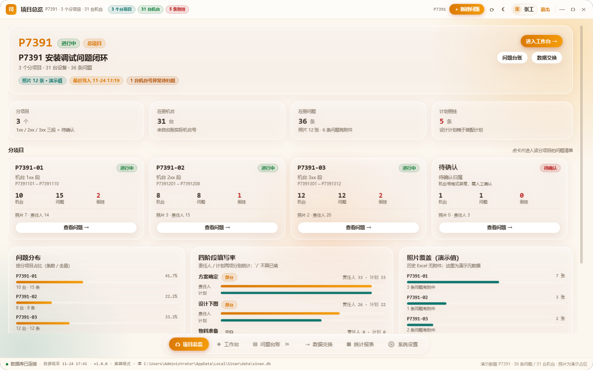 | 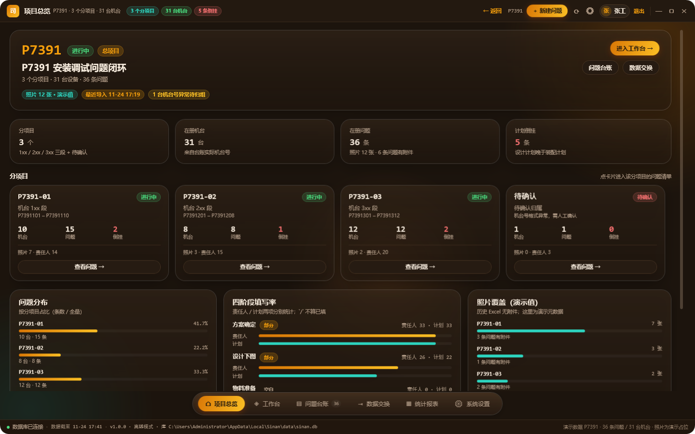 |

| 工作台：今天必须看的一件事 | 问题台账：倒挂优先排序 |
| --- | --- |
| 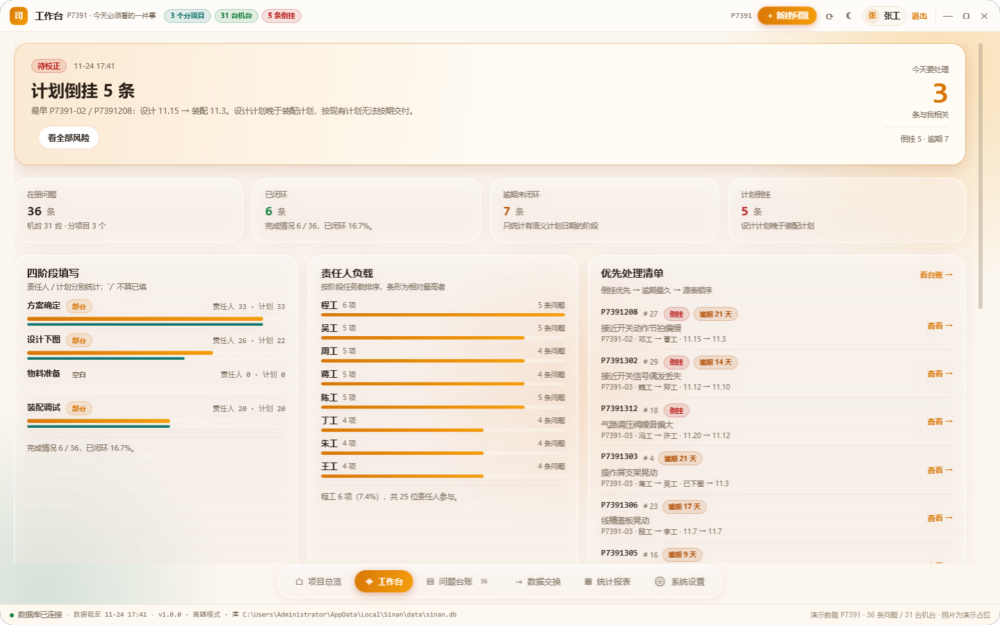 | 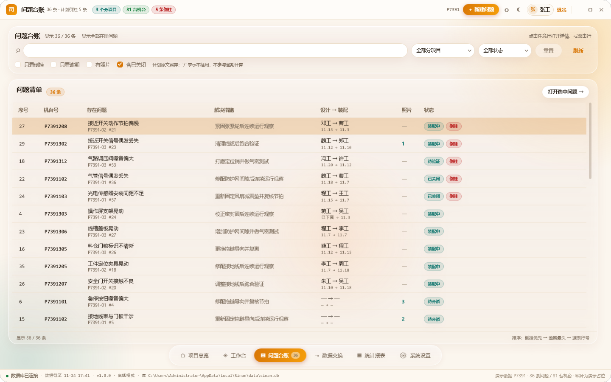 |

| 问题详情：四阶段逐段填 | 统计报表：口径全部实时算 |
| --- | --- |
| 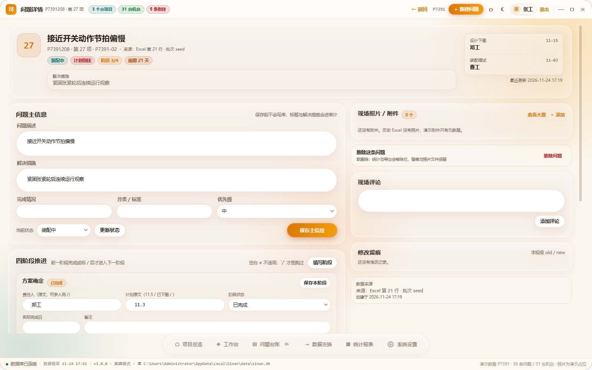 | 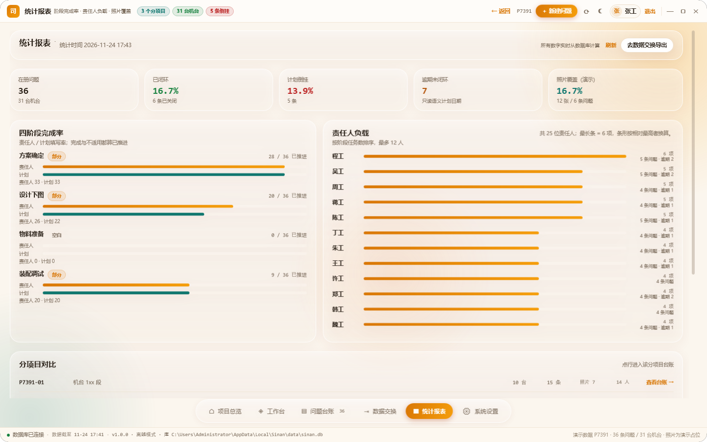 |

| 分项目 · 设备问题预览 | 数据交换：导入预览 / 导出三版式 |
| --- | --- |
| 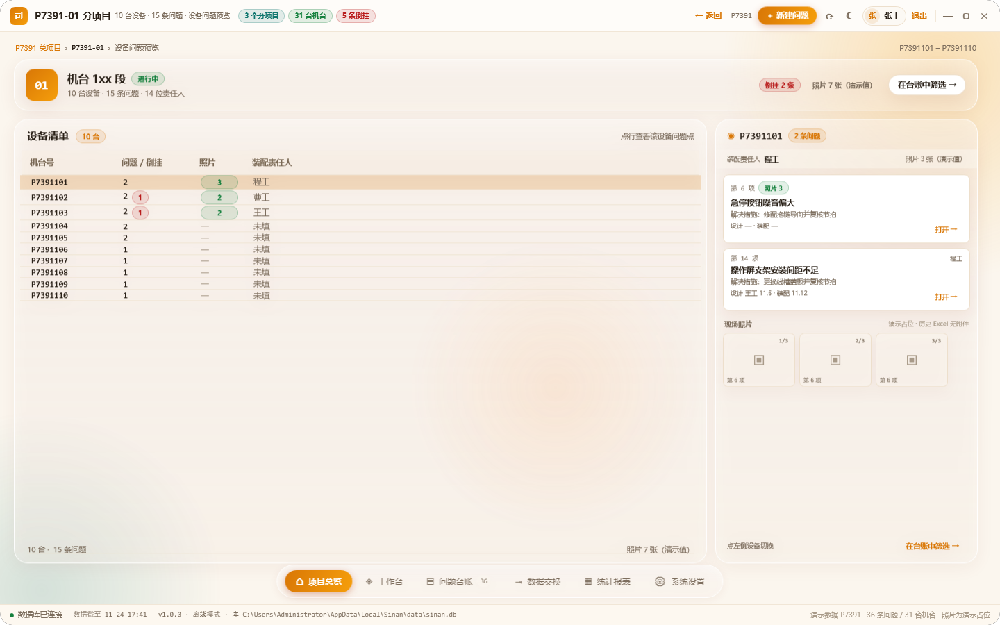 | 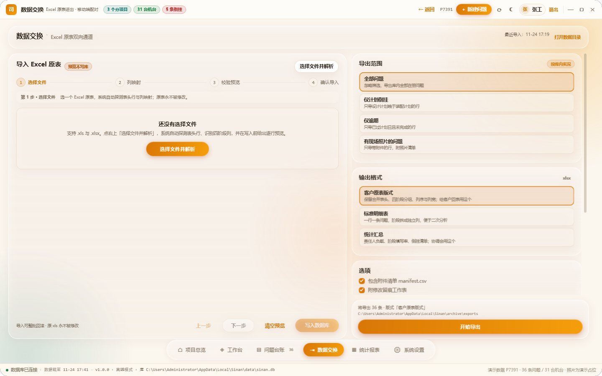 |

| 新建问题（弹窗） | 开始导出（弹窗） |
| --- | --- |
| 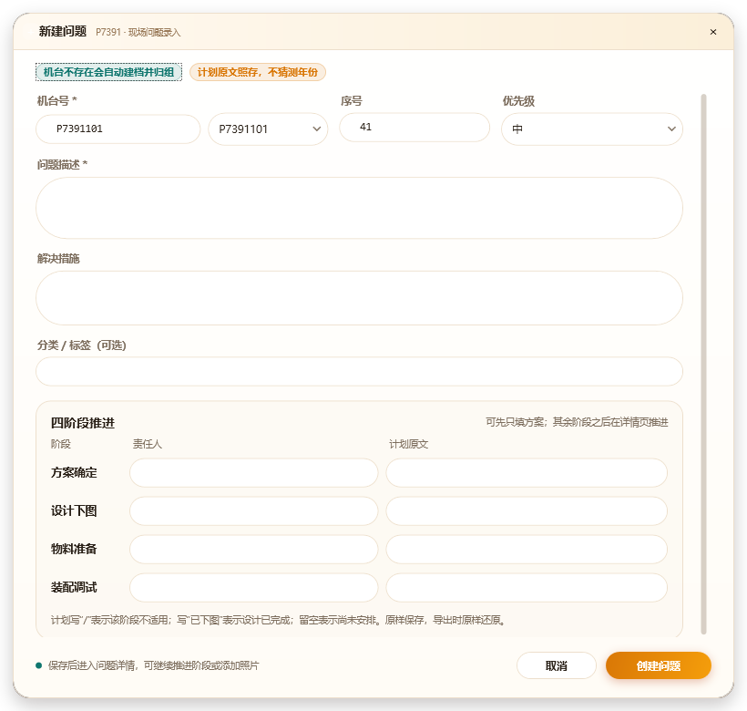 | 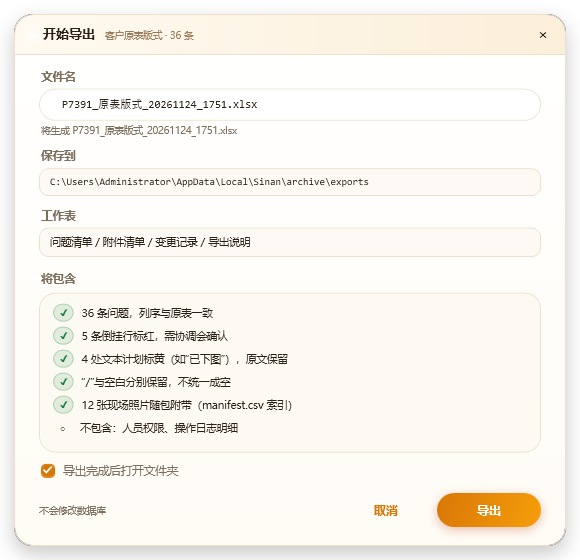 |

## 核心能力

**双端一套口径**

桌面端 WPF 是主库，手机端 Flutter 是离线副本。两端共用同一份 SQLite DDL 与同一份 36 条种子数据，字段语义不会各写一套。

**Excel 无损往返**

每个可能被人工改写的字段同时存语义值和原文。`due_date` 用于逾期计算，`due_raw` 用于原样导出——原表里写 `11.5`，导出还是 `11.5`，不会被"规范化"成 `2026-11-05`。`/`（不适用）与空白（未填）在数据库、统计、导出中始终区分。同时支持 `.xls` 与 `.xlsx`。

**导入前先看清，冲突逐条决策**

导入不是"选个文件就写库"。解析完先给预览：将写入几条、按 ID 更新几条、几条倒挂、几条是文本计划、几台机台号异常。同 ID 已存在且两边都改过的行算冲突，逐条显示"系统值 vs 原表值"，由人决定用哪边——不做全局开关静默丢数据。

**导出三种版式**

客户原表版式（三行表头、两级列组、列宽冻结，回给客户用）、标准明细（一行一条，四阶段拆独立列）、统计汇总（总览 + 责任人负载 + 阶段填写率 + 倒挂清单）。范围可按全部 / 仅倒挂 / 仅逾期 / 有照片筛选。

**四阶段推进带审计**

方案确定 → 设计下图 → 物料准备 → 装配调试，逐段填责任人与计划。改计划日必须写变更原因，字段级 old/new 全部留痕。状态机自动推导，也允许人工覆盖，覆盖同样留痕。

**界面只认数据库**

统计数字全部实时查库，XAML 里不写死任何结果值。明暗双主题一键切换，只换语义 Token，页面不出现硬编码色值。

## 账号与权限

首次启动自动建库并种入演示数据，两个演示账号：

| 账号 | 角色 | 说明 |
| --- | --- | --- |
| `engineer` | 工程师 | 日常记录、推进阶段、导入导出 |
| `admin` | 管理员 | 同上 + 人员与设置管理 |

> 演示口令为种子内置值，首次登录后应修改。正式交付时由交付人当面提供账号。

## 架构

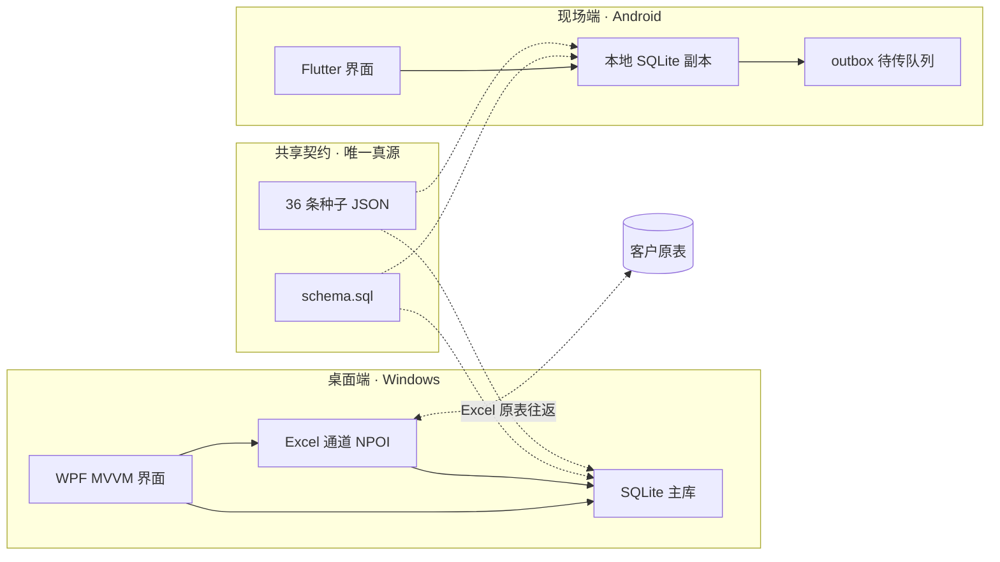

- **桌面端是唯一主库**，不做双主库双向合并；手机端是离线副本 + 待传队列。
- **跨端共享只放在 `shared/`**：数据库 DDL、种子、同步契约。两端互不引用对方源码。
- **通用 WPF 控件回写公司复用库** `Kaleidoscope.UI`（git submodule），司南只升级子模块指针。

## 目录结构

```text
Sinan/
├── AGENTS.md                  ← 项目规范（脱敏红线、数据模型、MVVM、验收清单）
├── desktop/                   ← ① Windows 桌面端（WPF 解决方案根）
│   ├── Sinan.sln
│   ├── src/
│   │   ├── Sinan.Core/        ← 领域模型、枚举、纯规则（无 UI / 无数据库）
│   │   ├── Sinan.Data/        ← SQLite 仓储、种子、Excel 通道
│   │   └── Sinan.App/         ← WPF：Views / ViewModels / Services / Themes
│   └── ThirdParty/            ← Windows 专用依赖
│       └── Kaleidoscope/      ← 公司级 WPF 复用库（git submodule）
├── mobile/                    ← ② 现场端（Flutter 工程根）
│   ├── lib/                   ← 主题 Token / 页面 / 状态 / 数据层
│   ├── assets/seed/           ← 与桌面端同一份 36 条种子
│   ├── test/                  ← 日期 / 状态 / 归组规则回归
│   └── android/               ← Flutter Android 宿主壳
├── shared/                    ← 双端共享契约（唯一真源）
│   ├── db/schema.sql          ← SQLite DDL
│   └── db/seed/               ← 36 条脱敏演示种子
├── docs/                      ← 设计稿、调研方案、截图
│   ├── ui_design_mockups.html ← 双端设计稿（单文件、离线可开）
│   ├── 调研与方案.md
│   └── images/                ← README 实机截图
└── tools/
    └── desensitize_scan.py    ← 脱敏扫描
```

> `source/`、`data/` 只用于本机真实资料自测，已在 `.gitignore` 中排除，不属于交付物，软件运行时也不读取。

## 技术基线

| 项 | 选型 |
| --- | --- |
| 桌面端 | .NET 10 + WPF（`net10.0-windows`），MVVM，自写最小 `ObservableObject` / `RelayCommand` |
| 现场端 | Flutter + Dart 3.14，MVVM，`sqflite` + `shared_preferences`（Android 可构建，iOS 仅设计支持） |
| 数据库 | SQLite（WAL，单文件），`Microsoft.Data.Sqlite` 10.0；15 张表 |
| Excel | NPOI 2.7.3，同时支持 `.xls`（BIFF8）与 `.xlsx` |
| 复用库 | `Kaleidoscope.UI`：窗基类、标题栏、胶囊圆角控件、圆角自检 |
| 界面基准 | 桌面 1440×900（最小 1280×800），现场端 390×844；明暗双主题 |

## 构建与运行

### 桌面端

```powershell
# 还原 + 构建
dotnet build desktop/Sinan.sln -c Debug

# 运行
dotnet run --project desktop/src/Sinan.App/Sinan.App.csproj
```

> 子模块首次拉取需要一并初始化：
> `git clone --recurse-submodules <repo-url>`，已克隆过的用 `git submodule update --init --recursive`。

### 现场端（Flutter）

```powershell
cd mobile
flutter pub get
flutter test          # 规则回归 14 条
flutter analyze       # 应为 0 issue
flutter build apk --debug
```

产物：`mobile/build/app/outputs/flutter-apk/app-debug.apk`。
Android 构建走国内镜像：Gradle 腾讯云、Maven 阿里云（已写入
`mobile/android/gradle/wrapper/gradle-wrapper.properties` 与 `settings.gradle.kts`）。
Flutter 资源与 pub 包建议设置 `FLUTTER_STORAGE_BASE_URL=https://storage.flutter-io.cn`、
`PUB_HOSTED_URL=https://pub.flutter-io.cn`。

### 运行时数据

不写入仓库，全部落在 `%LOCALAPPDATA%\Sinan`（可用环境变量 `SINAN_DATA_DIR` 覆盖）：

| 目录 | 内容 |
| --- | --- |
| `data\sinan.db` | 主库 |
| `attachments\` | 现场照片与附件 |
| `archive\` | 导入归档、导出产物 |
| `logs\` | 滚动文件日志 |

干净首启的种子规模：**36 条问题 / 31 台机台 / 144 条阶段 / 12 条演示附件 / 3 个分项目 / 2 个账号**。

## 当前进度

- [x] 需求澄清与方案调研：总项目 → 分项目 → 机台 → 问题 → 四阶段闭环
- [x] 双端 UI 设计稿：桌面 10 页 + 安卓 10 页 + 11 个弹窗（桌面 8 / 移动 3），单方案「晨光现场 · 精致玻璃态」× 明暗双主题
- [x] 桌面端工程骨架：`Sinan.Core` / `Sinan.Data` / `Sinan.App`，`Kaleidoscope.UI` 子模块接入
- [x] 数据层：SQLite DDL（15 张表）、脱敏种子（36 条 / 31 台）、仓储、统计口径
- [x] 桌面端 9 个业务页面：登录 / 项目总览 / 分项目设备预览 / 工作台 / 问题台账 / 问题详情 / 数据交换 / 统计报表 / 系统设置
- [x] 桌面端 6 个独立弹窗：新建问题 / 推进阶段 / 删除确认 / 查看照片 / 导入确认 / 导出确认
      （设计稿另 2 个桌面弹窗按实际形态落地：手机配对因服务未实现改为如实提示，分项目预览改为独立页面）
- [x] Excel 无损通道：`.xls` + `.xlsx`，36 条往返 0 新增 0 更新，冲突逐条决策
- [x] 附件与演示照片：上传 / 查看 / 导出 ZIP + `manifest.csv`
- [x] Flutter 现场端 6 个页面：登录 / 总览 / 台账 / 详情 / 数据交换 / 设置，离线 SQLite + outbox 记账
- [ ] **局域网同步服务**：当前为离线单机版，配对码 / Bearer / 增量同步尚未实现，界面如实提示不伪造连接状态
- [ ] **桌面端自动化测试**：`desktop/tests/Sinan.Tests` 目录已建，测试用例待补
- [ ] 现场端拍照与附件上传（移动端当前为占位）
- [ ] iOS 构建（需 macOS）

## 关键设计

**双字段存储**：导出优先用原文，语义值只参与计算。

```sql
due_date  TEXT          -- 2026-11-05，用于逾期计算
due_raw   TEXT          -- "11.5" / "已下图" / "/"，用于原样导出
```

**机台号带后缀**：`P7391\d{3}(-\d)?`。`P73913118` 属已知笔误，保留原文并归入"待确认"，**不静默改正**。

**软删除 + 审计**：问题删除只写 `deleted_at`，不物理删除；状态、责任人、计划时间变更写 `activity_log`，字段级 old/new。

**乐观锁**：所有可同步实体带 `version`，更新 `WHERE id=? AND version=?`，影响行数为 0 即判冲突。

## 已知限制

| 项 | 现状 |
| --- | --- |
| 局域网同步 | 未实现。当前为离线单机版，桌面端不监听端口，手机端不发起连接；界面如实提示，不伪造连接状态 |
| 移动端拍照上传 | 未实现，界面为占位 |
| 桌面端自动化测试 | `desktop/tests/Sinan.Tests` 目录已建，用例待补 |
| 传递依赖漏洞 | `SixLabors.ImageSharp` 2.1.10 中危（GHSA-rxmq-m78w-7wmc）。修复需 NPOI 升 2.8.x + OSMF 商业许可；本项目不调用 ImageSharp API，风险路径不走 |
| iOS | 仅设计支持，构建需 macOS |

## 数据脱敏

- 演示项目号、机台号、人员、问题标题、解决措施全部为虚构随机数据，唯一真源是 `shared/db/seed/issues.seed.json`。
- 真实原始表与解析样例只允许在本机 `source/`、`data/` 中使用，已 gitignore。
- 任何代码、文档、设计稿、截图、提交信息都不得出现真实数据。
- 提交前运行 `python tools/desensitize_scan.py`（敏感词清单由本机 `.sensitive.local` 提供，不入库）。

## 文档导航

| 文档 | 内容 |
| --- | --- |
| [`docs/ui_design_mockups.html`](docs/ui_design_mockups.html) | 双端设计稿，20 页 + 11 弹窗，浏览器直接打开（单文件、离线可用） |
| [`docs/调研与方案.md`](docs/调研与方案.md) | 业务规则、Excel 无损口径、架构与风险 |
| [`AGENTS.md`](AGENTS.md) | 项目规范：脱敏红线、数据模型红线、MVVM 约定、界面规范、验收清单 |
| [`CHANGELOG.md`](CHANGELOG.md) | 逐轮变更记录与修复说明 |
| [`shared/db/schema.sql`](shared/db/schema.sql) | SQLite DDL，双端唯一真源 |
| [`shared/db/seed/issues.seed.json`](shared/db/seed/issues.seed.json) | 36 条脱敏演示种子 |
